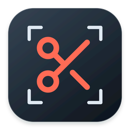
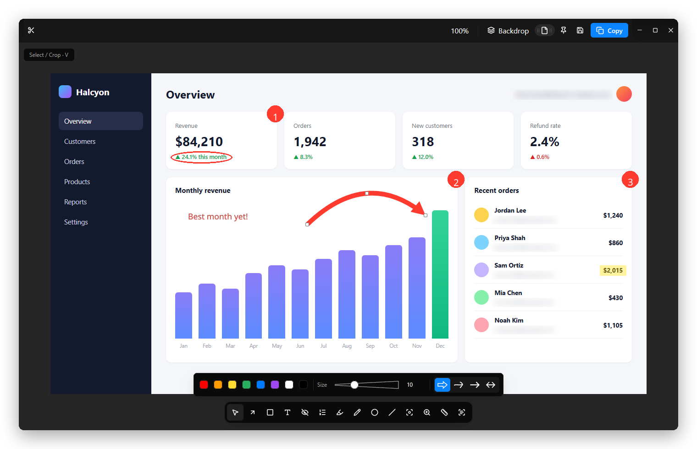
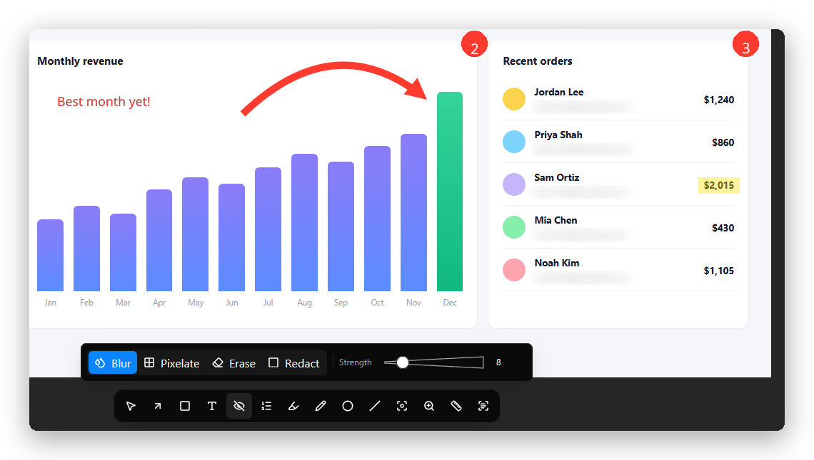
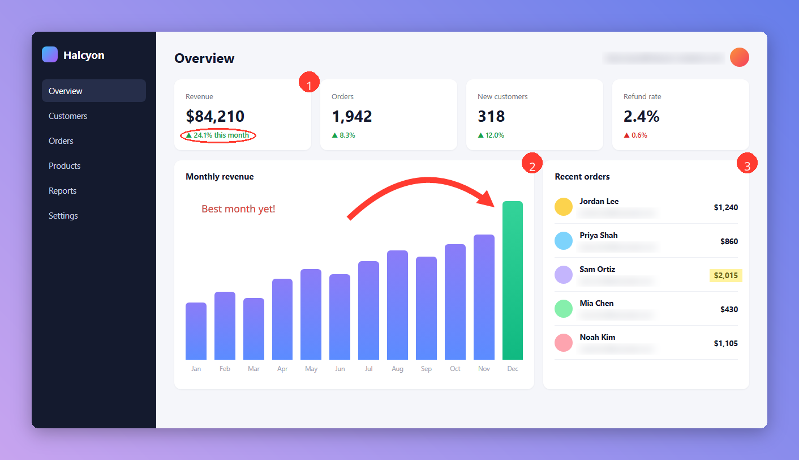
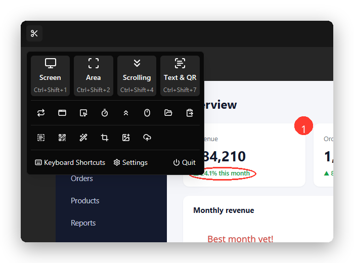

<div align="center">



# Sniplet

### Capture it. Mark it up. Share it.

A fast, native screenshot tool for Windows, macOS, and Linux.<br>
Free, open source, and written in Rust.

<br>

[](https://github.com/m4tta/sniplet/releases/latest)&nbsp;
[](https://github.com/m4tta/sniplet/releases/latest)&nbsp;
[](https://github.com/m4tta/sniplet/releases/latest)

<br>



</div>

<br>

<table>
<tr>
<td width="33%" valign="top">

**⚡ Instant**<br>
One shortcut freezes the screen. Drag across it, and the editor opens with your capture.

</td>
<td width="33%" valign="top">

**✏️ Always editable**<br>
Every arrow, label, and blur stays live. Move it, restyle it, or undo it at any time.

</td>
<td width="33%" valign="top">

**🔒 Keep it private**<br>
Blur, pixelate, or redact emails and names before anything leaves your screen.

</td>
</tr>
</table>

## Mark it up in seconds



Every tool lives in one dock at the bottom of the window. Pick one with a click
or a key, and its options float right above it.

| | |
| --- | --- |
| **Arrows and shapes** | Curved arrows, lines, rectangles, ovals, and freehand |
| **Text and steps** | Labels and numbered counters for step-by-step guides |
| **Focus** | Highlighter, spotlight, and a magnifier lens |
| **Hide** | Blur, pixelate, erase, or redact anything private |
| **Measure** | Hold <kbd>1</kbd> or <kbd>2</kbd> to measure widths and heights in pixels |
| **Read** | Drag the OCR tool over text or a QR code to copy what it says |

## Make it look good



Add a gradient backdrop with padding, rounded corners, and a shadow. Then copy
it, save it as PNG, JPEG, or WebP, drag it straight into another app, pin it on
top of your screen, or upload it.

## Everything one click away

<table>
<tr>
<td width="45%" valign="top">

</td>
<td valign="top">

Capture the **whole screen**, an **area**, a **window**, or a **scrolling page**.
Repeat your last area, read text or a QR code from anywhere on screen, or paste
an image from the clipboard.

Sniplet waits in the system tray (or the macOS menu bar) and can start with your
computer, so a capture is always one shortcut away.

</td>
</tr>
</table>

## Get started

1. **Download** the latest release for your system:

   | System | File |
   | --- | --- |
   | Windows | `Sniplet-…-windows-x64.zip` |
   | macOS, Apple silicon | `Sniplet-…-macos-arm64.dmg` |
   | macOS, Intel | `Sniplet-…-macos-x64.dmg` |
   | Linux | `Sniplet-…-linux-x64.tar.gz` |

2. **Capture.** Press <kbd>Ctrl/Cmd</kbd> <kbd>Shift</kbd> <kbd>2</kbd> and drag across the screen.
3. **Share.** Mark it up, then press <kbd>Ctrl/Cmd</kbd> <kbd>C</kbd> to copy.

<details>
<summary><b>All shortcuts</b></summary>

<br>

| Action | Shortcut |
| --- | --- |
| Capture an area | <kbd>Ctrl/Cmd</kbd> <kbd>Shift</kbd> <kbd>2</kbd> |
| Capture the screen | <kbd>Ctrl/Cmd</kbd> <kbd>Shift</kbd> <kbd>1</kbd> |
| Capture a window | <kbd>Ctrl/Cmd</kbd> <kbd>Shift</kbd> <kbd>3</kbd> |
| Scrolling capture | <kbd>Ctrl/Cmd</kbd> <kbd>Shift</kbd> <kbd>4</kbd> |
| Repeat the last area | <kbd>Ctrl/Cmd</kbd> <kbd>Shift</kbd> <kbd>5</kbd> |
| Capture the active window | <kbd>Ctrl/Cmd</kbd> <kbd>Shift</kbd> <kbd>6</kbd> |
| Read text or a QR code | <kbd>Ctrl/Cmd</kbd> <kbd>Shift</kbd> <kbd>7</kbd> |
| Reopen the editor | <kbd>Ctrl/Cmd</kbd> <kbd>Shift</kbd> <kbd>8</kbd> |

In the editor: <kbd>V</kbd> select, <kbd>A</kbd> arrow, <kbd>R</kbd> rectangle,
<kbd>T</kbd> text, <kbd>B</kbd> hide, <kbd>C</kbd> counter, <kbd>H</kbd> highlight.
Change any capture shortcut in **Settings → Hotkeys**.

</details>

<details>
<summary><b>Build from source</b></summary>

<br>

Install [stable Rust](https://rustup.rs), then:

```sh
git clone https://github.com/m4tta/sniplet.git
cd sniplet
cargo run --release -p sniplet-app -- --demo
```

See the [guide](docs/guide.md#native-prerequisites) for the native tools each
platform needs.

</details>

## Learn more

[User and developer guide](docs/guide.md) ·
[Feature checklist](docs/parity.md) ·
[Releases](docs/releases.md) ·
[Platform testing](docs/platform-testing.md)

Sniplet is in active development. Some features are still incomplete, and not
every platform has been fully tested yet.

<sub>Apache 2.0. Noto Sans is under the [SIL Open Font License](assets/fonts/OFL.txt). Icons from [Lucide](assets/icons/LICENSE-LUCIDE).</sub>
